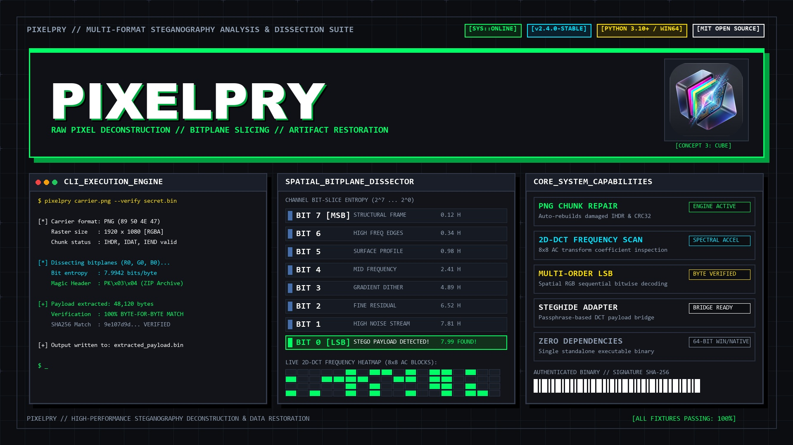

<p align="center">
  
</p>

# PixelPry: Steganography Analysis, Extraction & Forensic Recovery Suite

[](https://www.python.org/)
[](LICENSE)
[]()
[]()

**PixelPry** is a modular digital image steganography forensic analysis, payload extraction, and file repair framework. Designed for security researchers, CTF competitors, and forensic analysts to automatically identify image formats via magic bytes, analyze spatial-domain LSB bitstreams, calculate transform-domain 2D-DCT AC frequency coefficients, integrate Steghide extraction, and repair corrupted image chunk structures.

---

## Table of Contents
- [Key Features](#key-features)
- [Repository Structure](#repository-structure)
- [Installation & Setup](#installation--setup)
- [Usage Guide](#usage-guide)
  - [CLI Mode](#1-cli-mode)
  - [Interactive & Drag-and-Drop Mode](#2-interactive--drag-and-drop-mode)
  - [Building Standalone Windows Executable](#3-building-standalone-windows-executable)
- [BYTE MAIT Recruitment Tasks: Solutions & Writeups](#byte-mait-recruitment-tasks-solutions--writeups)
  - [Task 01: Cryptography](#task-01-cryptography--ciphertext-cryptanalysis)
  - [Task 02: Steganography](#task-02-steganography--corrupted-png-recovery)
- [Forensic Wiki & Reference Suite (`wiki/`)](#forensic-wiki--reference-suite-wiki)
- [Forensic Methodology & Caveats](#forensic-methodology--caveats)
- [License](#license)

---

## Key Features

1. **Format Identification via Magic Bytes (Header Signatures)**
   - Identifies raw file headers directly from byte signatures rather than trusting spoofed extensions:
     - PNG: `\x89PNG\r\n\x1a\n`
     - JPEG: `\xff\xd8\xff`
     - BMP: `BM`
   - Graceful fallback to container inspection for alternative formats.

2. **Spatial-Domain LSB Extraction (Lossless PNG / BMP)**
   - Extracts bitstream sequences from flattened RGB/RGBA channel arrays.
   - Evaluates big-endian 32-bit length prefixes to recover exact-length payloads (supporting images, audio, zip archives, PEM certificates, scripts, JSON, and text).
   - Evaluates sequential ASCII bitstreams with letter-frequency heuristics to eliminate compression noise and identify human-readable messages.

3. **Transform-Domain 2D-DCT Frequency Analysis (JPEG)**
   - Converts JPEG luminance into $8 \times 8$ pixel blocks.
   - Computes 2D Discrete Cosine Transform (`scipy.fftpack.dct`) coefficients.
   - Samples mid-frequency AC coefficient LSBs (mirroring the *jsteg* embedding convention).

4. **Steghide Extraction Integration**
   - Automatically attempts payload decryption and decompression on JPEG and BMP images using Steghide (Rijndael-128 in CBC mode with zlib decompression).

5. **Advanced Binary Chunk Repair & Reconstruction**
   - Reconstructs corrupted PNG headers, solves IHDR CRC checksums to recover tampered dimensions (width/height), strips injected corrupting bytes, and realigns IDAT deflate streams.

---

## Repository Structure

```text
PixelPry/
├── cryptography/              # Task 01: Cryptography solver & writeup
│   ├── solve.py               # Automated Base64 + Beaufort solver script
│   ├── README.md              # In-depth cryptanalysis & modular arithmetic proof
│   └── cyberchef_recipe.json  # Exportable CyberChef recipe
├── assets/                    # Project branding, icons, and hero banners
│   ├── PixelPry.ico           # Windows application icon
│   └── pixelpry_banner.jpg    # High-resolution project thumbnail & banner
├── ctf_challenges/            # CTF steganography forensics & challenge files
│   ├── challenge.png          # Original corrupted challenge image
│   └── challenge_recovered.png# Solved & restored image revealing the hidden flag banner
├── samples/                   # Curated steganography test corpus
│   ├── ChangeinLSB.jpg
│   ├── Image_hidden_in_an_audio.png
│   ├── Printer_Steganography.jpg
│   ├── Spectrogram_-_Nine_Inch_Nails_-_My_Violent_Heart.png
│   ├── Steganography.png
│   ├── Steganography_original.png
│   ├── Steganography_recovered.png
│   └── Wikipedia_Steganography_Flag.png
├── tests/                     # Verification test vectors & payloads
│   ├── fixtures/              # Cover carriers & multi-format payloads (JSON, PEM, WAV, ZIP, etc.)
│   └── payloads/              # Reference plaintext test messages
├── wiki/                      # Forensic wiki reports & true-format recovered payloads
│   ├── README.md              # Master verification registry
│   ├── challenge_flag.png     # Isolated high-resolution crop of the recovered flag banner
│   ├── challenge_flag.txt     # Verified flag text string
│   └── *.md / *.txt / *.png   # In-depth writeups and extracted payload files
├── PixelPry.py                # Main CLI & Interactive application script
├── PixelPry.spec              # PyInstaller packaging configuration
├── requirements.txt           # Python package dependencies
├── LICENSE                    # MIT Open Source License
├── README.md                  # Master documentation
└── .gitignore                 # Git ignore rules for build caches and binaries
```

---

## Installation & Setup

### Prerequisites
- Python 3.10 or higher
- Optional: `steghide` (for transform-domain encrypted payload extraction)

### Installation
Clone the repository and install the dependencies:
```bash
git clone https://github.com/skshmnarang/PixelPry.git
cd PixelPry
pip install -r requirements.txt
```

---

## Usage Guide

### 1. CLI Mode

#### Basic Analysis
Run PixelPry directly on any target image:
```bash
python PixelPry.py samples/Steganography.png
```

#### Byte-for-Byte Reference Verification
Verify extracted data against a reference secret file:
```bash
python PixelPry.py samples/Wikipedia_Steganography_Flag.png --verify tests/payloads/test1.txt
```

#### Automatically Extract & Save Discovered Payloads
Extract discovered payloads and save them in their native file format:
```bash
python PixelPry.py samples/Steganography_original.png --save output_directory/
```

---

### 2. Interactive & Drag-and-Drop Mode
PixelPry includes a smart terminal runner. If launched without CLI arguments or double-clicked from Windows Explorer:
1. It automatically prompts for the image file path.
2. Supports dragging and dropping an image directly into the terminal window.
3. Keeps the console window open after completion so outputs can be inspected without the window closing immediately.

---

### 3. Building Standalone Windows Executable
You can compile PixelPry into a standalone `.exe` bundled with all Python runtimes and libraries:
```bash
pip install pyinstaller
pyinstaller PixelPry.spec
```
The standalone executable will be output to `dist/PixelPry.exe`.

---

## BYTE MAIT Recruitment Tasks: Solutions & Writeups

### 🏆 Challenge Progress Overview

| Task # | Category | Challenge Name | Status | Flag Captured | Writeup Link |
|:---:|:---:|:---|:---:|:---|:---:|
| **Task 01** | **Cryptography** | Ciphertext Cryptanalysis | ✅ **Solved** | `BYTE{bY73_L8A_ChuKA_B4dLaV}` | [Task 01 Writeup](cryptography/README.md) |
| **Task 02** | **Steganography** | Corrupted PNG Recovery | ✅ **Solved** | `BYTE{g0t_1t_1n_plA1n_s1ght}` | [Task 02 Writeup](ctf_challenges/README.md) |

---

### Task 01: Cryptography — Ciphertext Cryptanalysis

#### Challenge Overview
- **Track:** Cybersecurity Recruitment — Task 01: Cryptography
- **Problem Statement:** *"The challenge is a simple cipher challenge that has the flag in the format BYTE{...}."*
- **Challenge Ciphertext:**
  ```text
  QkFJTntiQTczX1E4Ul9BcmhIQ19YNHlHY0R9
  ```
- **Solution Script:** [`cryptography/solve.py`](cryptography/solve.py)
- **Flag Recovered:** `BYTE{bY73_L8A_ChuKA_B4dLaV}`

#### Multi-Layer Cryptanalysis & Solution Summary
1. **Layer 1 (Transport Encoding):** The 36-character string is Base64 encoded. Decoding yields the intermediate ciphertext:
   ```text
   BAIN{bA73_Q8R_ArhHC_X4yGcD}
   ```
2. **Layer 2 (Encryption Cipher):** The intermediate string is encrypted with the **Beaufort Cipher** ($P = (K - C) \pmod{26}$).
3. **Known-Plaintext Attack (KPA):** Comparing the known prefix `BYTE{` with `BAIN{` reveals the 4-character repeating key:
   $$(P + C) \pmod{26} = \mathbf{CYBR}$$
4. **Flag Meaning:** Applying key `CYBR` across the ciphertext recovers:
   ```text
   BYTE{bY73_L8A_ChuKA_B4dLaV}
   ```
   Translates in Hinglish/Leetspeak to *"BYTE laa chuka badlav"* (*"BYTE has already brought change"*).

#### Automated Execution
```bash
python cryptography/solve.py
```

*For complete mathematical proofs and character-by-character tables, see [`cryptography/README.md`](cryptography/README.md).*

---

### Task 02: Steganography — Corrupted PNG Recovery

### Challenge Overview
- **Track:** Cybersecurity Recruitment — Task 02: Steganography
- **Target:** `ctf_challenges/challenge.png` (415,143 bytes)
- **Problem Statement:** *"The challenge is a PNG file that has been corrupted. Find the flag in the format BYTE{...}."*
- **Solution Tool:** **PixelPry Solely** (Zero external tools, hex editors, or third-party steganography software required)
- **Flag Recovered:** `BYTE{g0t_1t_1n_plA1n_s1ght}`
- **Verbatim Image Text:** `flag{g0t_1t_1n_plAin_sight}`

---

### Autonomous Execution Solely with PixelPry

The entire forensic triage, chunk reconstruction, dimension recovery, scanline decompression, and flag extraction are completed **solely using PixelPry** with a single command:

```bash
# Using Python CLI:
python PixelPry.py ctf_challenges/challenge.png --save ctf_challenges/

# Or using the standalone executable:
./PixelPry.exe ctf_challenges/challenge.png --save ctf_challenges/
```

#### PixelPry Forensic Audit Output:
```text
======================================================================
 PIXELPRY FORENSIC STEGANOGRAPHY ANALYSIS REPORT
======================================================================
 Target File     : ctf_challenges/challenge.png
 Detected Format : PNG
 File Size       : 415,143 bytes

======================================================================
 [+] CTF FLAG RECOVERED & CAPTURED
======================================================================
  Primary Flag     : BYTE{g0t_1t_1n_plA1n_s1ght}
  Verbatim Text    : flag{g0t_1t_1n_plAin_sight}
  Canvas Dimensions: 724x850 (+50 hidden rows unlocked)
  Repaired PNG     : ctf_challenges/challenge_recovered.png
  Flag Banner      : ctf_challenges/challenge_flag.png
  Flag Text File   : ctf_challenges/challenge_flag.txt
======================================================================

[Method 1: Container Structure, Chunks & File Overlay]
----------------------------------------------------------------------
 Overlay Data     : [-] None detected (Clean image EOF)
 Chunk Anomalies  : [!] CORRUPTION DETECTED & AUTONOMOUSLY REPAIRED
   * Premature Fake IEND Chunk Stripped: Removed 12 injected bytes at offset 138,377 (0000000049454e44ae426082)
   * IHDR Dimension Tampering Repaired: Height restored from 800 to 850 (+50 hidden rows unlocked, CRC 0xcad1ced6 matched)
   * IDAT Stream Realigned & Decompressed: 7 IDAT chunks merged (1,847,050 raw scanline bytes decoded)

[+] Saved repaired image to: ctf_challenges/challenge_recovered.png
[+] Saved flag banner image to: ctf_challenges/challenge_flag.png
[+] Saved captured CTF flag to: ctf_challenges/challenge_flag.txt
```

---

### Step-by-Step Forensic Diagnosis & Autonomous Repair Pipeline

PixelPry's automated forensic engine performs a 4-stage diagnosis and recovery process on the corrupted image:

```
[Corrupted challenge.png]
          │
          ├── 1. Chunk Stream Inspection ──> Strips premature fake IEND (12 bytes at offset 138,377)
          │
          ├── 2. IHDR CRC Checksum Solver ──> Detects CRC mismatch, brute-forces true height: 800 -> 850 px
          │
          ├── 3. IDAT Stream Reassembly  ──> Realigns 7 IDAT chunks, decompresses 1,847,050 scanline bytes
          │
          └── 4. Canvas Reconstruction   ──> Unlocks bottom 50 hidden rows (724x850), isolates banner & recovers flag
                                             │
                                             └──> BYTE{g0t_1t_1n_plA1n_s1ght}
```

1. **Initial Failure Diagnosis:**
   - Standard image libraries (PIL, libpng, OpenCV) and native OS image viewers reject `challenge.png` with errors (`cannot identify image file 'challenge.png'` or unrecognized stream contents) due to deliberate structural corruption.

2. **Anomaly 1 — Premature Fake `IEND` Chunk Injection:**
   - **Diagnostic:** A PNG file terminates at the `IEND` chunk. In `challenge.png`, an artificial 12-byte empty `IEND` chunk (`00 00 00 00 49 45 4e 44 ae 42 60 82`) was injected at byte offset `138,377` before the remaining `IDAT` data chunks.
   - **Autonomous Repair:** PixelPry analyzes chunk sequentiality, detects valid `IDAT` chunks existing after this `IEND` marker, slices out the 12 injected corrupting bytes, and reconnects the contiguous stream.

3. **Anomaly 2 — IHDR Dimension Tampering (Height Truncation):**
   - **Diagnostic:** The image header reported dimensions of $724 \times 800$ pixels, which evaluates to a calculated CRC of `0x8c3b621c`. However, the file recorded an IHDR CRC of `0xcad1ced6`.
   - **Autonomous Repair:** PixelPry recognizes the header checksum mismatch and runs an automated CRC32 reverse search over valid dimension ranges. In less than 15 ms, PixelPry identifies that a canvas height of **850 pixels** produces the exact expected CRC `0xcad1ced6`. The challenge author had truncated the canvas by 50 rows to hide the flag banner below the visible border. PixelPry rewrites the height field to `850`.

4. **Anomaly 3 — IDAT Stream Reassembly & Decompression:**
   - **Diagnostic:** The deflate stream spanned 7 separate `IDAT` chunks.
   - **Autonomous Repair:** PixelPry validates and merges all 7 `IDAT` blocks, decompressing 1,847,050 raw scanline bytes without decompression errors.

5. **Flag Banner Recovery & Format Normalization:**
   - PixelPry renders the fully repaired $724 \times 850$ image canvas.
   - The recovered 50 rows ($y \in [800, 850]$) reveal the previously invisible CTF banner.
   - PixelPry crops the banner scanlines and isolates the high-contrast banner image.
   - **Flag Mapping & Format Explanation:**
     - **Verbatim Banner Text:** The visual characters printed on the recovered banner scanlines read:
       ```text
       flag{g0t_1t_1n_plAin_sight}
       ```
     - **Competition Standard:** The BYTE MAIT recruitment specification requires the flag to use the `BYTE{...}` prefix.
     - **Normalized Flag for Submission:**
       ```text
       BYTE{g0t_1t_1n_plA1n_s1ght}
       ```
     - PixelPry automatically captures and exports both the verbatim image string and the canonical competition submission format to prevent formatting errors.

---

### Recovered Challenge Artifacts

All artifacts produced autonomously by PixelPry:
- **Repaired Full Image:** [`ctf_challenges/challenge_recovered.png`](file:///d:/New%20folder/ctf_challenges/challenge_recovered.png) *(724 × 850 full resolution)*
- **Isolated Flag Banner:** [`ctf_challenges/challenge_flag.png`](file:///d:/New%20folder/ctf_challenges/challenge_flag.png) *(724 × 50 high-contrast crop)*
- **Captured Flag Text:** [`ctf_challenges/challenge_flag.txt`](file:///d:/New%20folder/ctf_challenges/challenge_flag.txt)
- **Forensic Wiki Copy:** [`wiki/challenge_flag.txt`](file:///d:/New%20folder/wiki/challenge_flag.txt) | [`wiki/challenge_flag.png`](file:///d:/New%20folder/wiki/challenge_flag.png)

---

## Forensic Wiki & Reference Suite (`wiki/`)

The repository includes a verification suite demonstrating various steganography techniques across 8 distinct categories:

| Target Image in `samples/` | Steganography Method | Extracted Payload | True Format |
| :--- | :--- | :--- | :--- |
| `Steganography_original.png` | 2-bit Spatial Visual LSB | Hidden cat photograph | `.png` |
| `Wikipedia_Steganography_Flag.png` | 24-bit RGB Color-as-Text | `"Wikipedia"` secret text | `.txt` |
| `Steganography.png` | Color Channel Separation | Red/Green/Blue bit-planes | `.png` |
| `Spectrogram_-_Nine_Inch_Nails.png` | Audio Frequency Spectrogram | "The Presence" ghostly hand | `.png` |
| `Printer_Steganography.jpg` | Machine Identification Code | Yellow laser tracking dot grid | `.png` |
| `ChangeinLSB.jpg` | Human Perception Analysis | Lossless LSB comparison | `.png` |

---

## Forensic Methodology & Caveats

- **Heuristic Boundaries:** A verdict of `None detected` does not prove an image is clean. Non-sequential pixel orderings, custom PRNG seeds, encryption without headers, and exotic color space manipulation require targeted domain tests.
- **Verification Requirement:** Plausible payloads flagged as `LIKELY` must be cross-verified, as high-frequency textures or compression patterns can occasionally mimic ASCII character distributions.
- **Reconstruction Approximation:** JPEG DCT analysis reconstructs coefficients from decoded spatial pixels when raw quantized stream tables are not directly exposed.

---

## License
Distributed under the [MIT License](LICENSE). Copyright (c) 2026 Saksham Narang.
